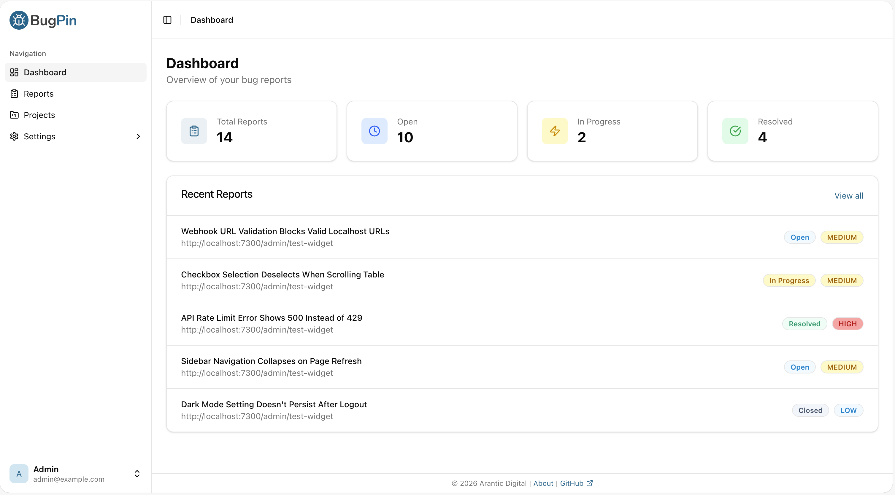
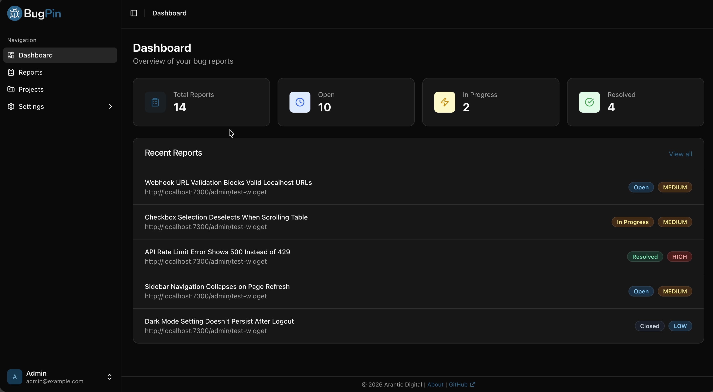

<div align="center">
    <picture>
        <source media="(prefers-color-scheme: dark)" srcset="src/admin/public/branding/dark/logo-dark.svg" />
        
    </picture><br /><br />
    <p><big><strong>The self-hosted, open-source visual bug reporting tool.</strong></big><br />
    Capture screenshots and screen recordings, annotate issues, and track bugs from your web applications.</p>
    <!-- <a target="_blank" href="https://github.com/aranticlabs/bugpin"></a> -->
    <a target="_blank" href="https://github.com/aranticlabs/bugpin"></a>
    <a target="_blank" href="https://github.com/aranticlabs/bugpin/blob/main/LICENSE"></a>
    <a target="_blank" href="https://github.com/aranticlabs/bugpin/blob/main/src/widget/LICENSE"></a>
</div>
<br />

### Admin Console

Manage projects and triage reports. Light and dark mode out of the box.

**Light Mode**



**Dark Mode**



### Widget

Capture screenshots, record the screen, and annotate issues from any page on your site.


- Embeds with a single script tag. Works with React, Vue, Angular, Svelte, or vanilla JS
- Shadow DOM isolation: widget styles never leak into your site, and your CSS never bleeds into the widget
- Offline-safe: reports are cached locally and synced when the connection returns
- Annotation tools: pen, shapes, arrows, text, privacy blur
- Screen recording with a pen, laser pointer, click effects, and optional microphone audio; recordings survive a crash or reload
- Translated into 8 languages (English, German, French, Dutch, Spanish, Italian, Japanese, Simplified Chinese) with automatic detection

# Features

- **Visual Bug Reporting** - Capture screenshots with one click
- **Annotation Tools** - Draw, highlight, and annotate screenshots
- **Screen Recording** - Record the page from the widget or attach a video, with quality, duration, size, and daily upload limits set globally or per project
- **Automated Metadata Collection** - Failed network requests (4xx, 5xx), console errors, and OS/browser/device info captured automatically
- **Offline Support** - Reports are buffered and sent when back online
- **Self-Hosted** - Your data stays on your servers
- **Reporter Portal** - Email sign-in, private feedback history, conversations and progress tracking; see the [setup and deployment guide](docs/reporter-portal.md)
- **Multi-Project** - Manage multiple projects with separate API keys
- **Multilingual Widget** - Widget and reporter emails translated into 8 languages, with per-project language settings
- **Export Diagnostics** - Export a report's full context as Markdown, plain text, an AI prompt, or JSON, with section toggles and redactions
- **Enhanced Security Features** - Domain whitelists, configurable rate limiting, HSTS, and secure headers
- **GitHub Integration** - Forward reports to GitHub Issues, with optional public links to attached videos
- **Dark Mode** - Admin Console supports light and dark themes

# Quick Start

Get BugPin up and running in under 5 minutes. This guide will walk you through the basic setup to start capturing and managing bug reports.

## Install

### Docker Compose

Create a `docker-compose.yml` file:

```yaml
services:
  bugpin:
    image: registry.arantic.cloud/bugpin/bugpin:latest
    container_name: bugpin
    restart: unless-stopped
    ports:
      - '7300:7300'
    volumes:
      - ./data:/data
    environment:
      TRUST_PROXY: 'false'
```

Then run:

```bash
# Start BugPin
docker compose up -d
```

### Docker Run

```bash
# Run BugPin container
docker run -d \
  --name bugpin \
  --restart unless-stopped \
  -p 7300:7300 \
  -v bugpin-data:/data \
  registry.arantic.cloud/bugpin/bugpin:latest
```

BugPin will be available at `http://localhost:7300`

### Reverse Proxy

BugPin rate-limits logins and widget submissions per client address. It reads `X-Forwarded-For` only from proxies it trusts, set with `TRUST_PROXY`:

| Value            | Behavior                                                                                        |
| ---------------- | ----------------------------------------------------------------------------------------------- |
| `auto` (default) | Trust forwarded headers from loopback and private-network proxies (same host or Docker network) |
| `true`           | Trust forwarded headers from any connecting proxy (for example a CDN with a public address)     |
| `false`          | Ignore forwarded headers and use the connection address                                         |

The quick-start `docker-compose.yml` publishes port 7300 directly and sets `TRUST_PROXY=false`, so clients cannot choose their own address with a forged header. Behind a reverse proxy, set `TRUST_PROXY=auto` (or `true` for a proxy with a public address) and make sure the proxy sets or appends `X-Forwarded-For`. IPv6 clients are rate-limited per /64 network.

If **Enforce HTTPS** is turned on without a working TLS proxy, every request redirects to HTTPS and the Admin Console becomes unreachable. Start BugPin with `DISABLE_HTTPS_ENFORCEMENT=true` to ignore the setting, sign in, turn the setting off, then remove the variable and restart. BugPin logs a warning while the variable overrides an enabled setting.

## Login

On first start, BugPin creates an admin account from these environment variables:

| Variable         | Default             |
| ---------------- | ------------------- |
| `ADMIN_EMAIL`    | `admin@example.com` |
| `ADMIN_PASSWORD` | `changeme123`       |

The initial password only works once. After the first login, BugPin asks you to choose a new password before you can use the Admin Console or the API. Instances that still use the initial password after an update ask for the change on the next login.

> [!NOTE]
> The variables are only read when no users exist yet. Changing them later does not change an existing account. Development mode (`make dev`) does not require the password change.

## Create a Project

Projects organize bug reports and provide the API key used by the widget.

1. Open the Admin Console and go to **Projects**
2. Click **Create Project** and enter a name
3. Copy the **API Key** shown after creation. You'll need it in the next step.

## Widget Integration

Pick whichever method fits your stack. Replace `YOUR_API_KEY` with the key from the previous step.

### Option 1: Script Tag

Add this before the closing `</body>` tag:

```html
<!-- Start of BugPin Widget -->
<script src="http://localhost:7300/widget.js" data-api-key="YOUR_API_KEY"></script>
<!-- End of BugPin Widget -->
```

No `serverUrl` needed: the widget reads it from the script tag automatically.

### Option 2: npm Package

Install via your bundler (Vite, webpack, etc.):

```bash
npm install @arantic/bugpin-widget
```

Then initialize in your app:

```javascript
import BugPin from '@arantic/bugpin-widget';

await BugPin.init({
  apiKey: 'YOUR_API_KEY',
  serverUrl: 'http://localhost:7300',
});
```

When using the npm package, `serverUrl` is required since the widget no longer loads from a `<script>` tag.

## Full Documentation

Full documentation is available at [docs.bugpin.io](https://docs.bugpin.io):

- [Docker Installation](https://docs.bugpin.io/installation/docker)
- [Bun Installation](https://docs.bugpin.io/installation/bun)
- [Reverse Proxy](https://docs.bugpin.io/installation/reverse-proxy)
- [Configuration](https://docs.bugpin.io/configuration/server)
- [Widget Installation](https://docs.bugpin.io/widget/installation)
- [GitHub Integration](https://docs.bugpin.io/integrations/github)
- [API Reference](https://docs.bugpin.io/api/overview)
- [Security](https://docs.bugpin.io/security/settings)

## Tech Stack

- **Server**: Bun, Hono, SQLite
- **Admin Console**: React, TanStack Query, Tailwind CSS
- **Widget**: Preact, Fabric.js, Shadow DOM

## Support

- [GitHub Issues](https://github.com/aranticlabs/bugpin/issues) - Bug reports and feature requests
- [Documentation](https://docs.bugpin.io) - Guides and reference

## Contributing

Contributions are welcome! Please read [CONTRIBUTING.md](CONTRIBUTING.md) before submitting pull requests.

## License

BugPin uses a multi-license approach:

- **Server & Admin Console**: [AGPL-3.0](LICENSE)
- **Widget**: [MIT](https://github.com/aranticlabs/bugpin/blob/main/src/widget/LICENSE)

Enterprise Edition features are proprietary and not open-source software. They are covered by the [BugPin Business License](LICENSE-EE).
